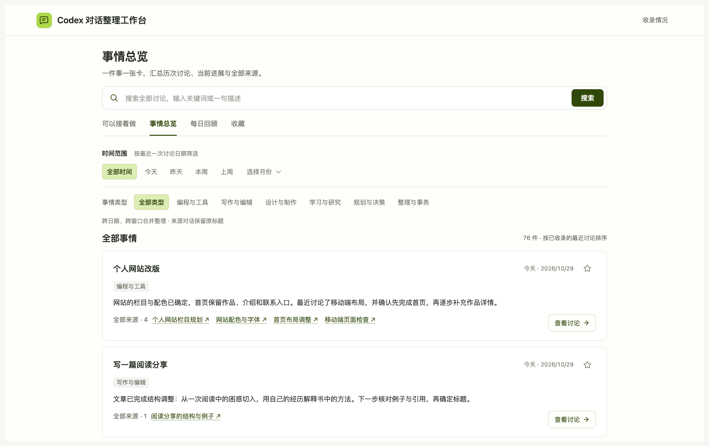
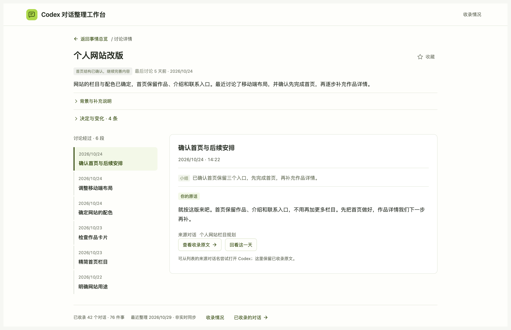

<div align="center">

# Codex 对话整理工作台

**聊过的事，不必再翻几十个窗口。**

把散落的 Codex 对话整理成一个本地网页，找回方案、回看决定、接上之前的讨论。

[开始使用](#开始使用) · [三个使用场景](#三个使用场景) · [常见问题](#常见问题)

</div>



<p align="center"><sub>真实网页截图 · 展示文字已脱敏替换</sub></p>

## 三个使用场景

我在 Codex 里聊过、做过的事情越来越多，窗口也越积越多。后来发现，困难不只是“窗口太乱”：有些事忘了继续，有些方案找不回来，同一件事的来龙去脉也散在不同地方。这个工作台，就是为了解决下面三个场景，一点点做出来的。

### 1. 有些事情还可以继续，但我已经忘了

窗口里可能留着尚未结束的事情、做到一半的项目，或聊到一半还想深入的话题。隔了几天再打开 Codex，往往已经想不起之前做到了哪一步，也不知道哪些事情可以接着做。

**“可以接着做”把这些讨论停点整理出来**，让你重新看见它们。进展不明确的会放在“进展待确认”；已经在别处处理完的，可以移出，不用专门回到原窗口补一句“做完了”。

### 2. 明明聊过，却找不到在哪个窗口

我用 Codex 搜索时，遇到过等待很久、记不准原话就搜不到的情况。只看窗口名字也不够：一个窗口里经常接连做了好几件事，标题只能提示其中一部分。

**工作台按事情整理，并搜索已收录的讨论正文**。输入几个关键词或一句大概描述，先认出相关事情，再看匹配片段、日期和原话。找东西不再只靠回忆窗口叫什么；相近候选也能展开核对，但不保证每种说法都能命中。

<details>
<summary>查看搜索页面</summary>


</details>

### 3. 想看清一件事怎么发展，也想回看某一天做了什么

同一件事可能在几个窗口里推进，前后又改过方向。只翻单个窗口，很难拼出完整经过。

- **按事情看**：“事情总览”把不同窗口里围绕同一目标的讨论串起来，整理小结、关键决定和变化。点进详情，可以沿着讨论经过回看当时怎么说、后来怎么改。
- **按日期看**：“每日回顾”把同一天的讨论放在一起，快速浏览当天聊了哪些事、有哪些进展。记得大致日期时，也能从这里定位。

这两种方式指向同一批讨论：一种帮你看一件事的脉络，一种帮你回看一天的内容。

<details>
<summary>查看讨论详情</summary>



</details>

**找到以后，还能直接回到 Codex。** 事情列表、每日回顾、搜索结果和接续卡片中的来源对话名都可以点击，打开对应的 Codex 窗口，继续讨论或查看完整现场。临时想留着的事情，也可以加入收藏。

## 开始使用

你需要在电脑上使用支持本地 Skill 的 Codex。**Skill 就是一套交给 Codex 执行的操作流程**，安装和整理都可以让它帮你完成，不用自己写代码。

### 1. 把这段话发给 Codex

新建一个对话，复制下面这段发送：

```text
请安装这个 Skill，并带我完成首次初始化：
https://github.com/LuKK351/lukk-codex-workbench
```

### 2. 选择先整理哪些讨论

Codex 会让你确认时间范围、保存位置和分类。保存位置与分类都有建议，可以直接沿用。

建议从 **近 1 个月** 开始，先看看整理效果；如果你只是偶尔使用 Codex，也可以选近 3 个月。想找更早的内容，可以直接指定日期。

<details>
<summary>不知道选多长时间？展开看看适合你的范围</summary>

| 整理范围 | 适合的情况 | 建议 |
| --- | --- | --- |
| **近 1 个月（推荐起步）** | 你几乎每天都在 Codex 里讨论或处理事情，已经积累了不少窗口；想先看看这些内容整理成工作台后的效果。 | 先整理近期内容，确认小结、分类和查找方式是否符合需要，再补充更早的讨论。 |
| **近 3 个月** | 你只是偶尔使用 Codex，最近一个月的内容不多；或者需要一起回看过去几个月持续推进的事情。 | 覆盖更长一段时间。如果每天都有大量讨论，首次整理也可能需要较长时间。 |
| **自选时间范围** | 你已经知道想找哪个时期的内容，例如半年前讨论过的一个方案。 | 直接选择相关日期，不必为了找旧讨论，把中间所有月份都整理一遍。 |

</details>

### 3. 在常用浏览器里打开网页

首批整理好后，Codex 会给你网页地址，随后继续处理选定范围。需要整理的讨论越多、内容越长，首次等待通常也越久；过程中会告知进度，遇到中断会保存恢复点。

建议在**常用浏览器**打开这个地址，先搜索一件你记得的事，点进去核对小结与原话。收藏和“接着做”的确认、移出选择保存在当前浏览器，切换浏览器或网页地址不会自动同步。

## 以后怎么更新

平时直接打开网页搜索、回看。需要新增内容时，在 Codex 中说：

> 更新一下我的对话整理工作台。

也可以让它补充更早的讨论，或按你的要求设置定时更新：

> 帮我设置每天早上 8 点更新工作台。

网页不是实时同步。定时功能需要 Codex 环境支持，并保持相关运行环境可用；安装时不会自动开启。

## 常见问题

<details>
<summary>会修改原对话，或者把我的内容公开吗？</summary>

不会删改原来的 Codex 对话。工作台文件保存在你的电脑上，安装这个公开仓库也不会把聊天上传到 GitHub。整理仍由你的 Codex 环境处理，不代表 AI 整理完全离线。

分享给朋友时，发送本仓库链接即可，不要分享装有私人内容的工作台文件夹。

</details>

<details>
<summary>能整理全部历史吗？包含 ChatGPT 和图片吗？</summary>

首次由你选择时间范围，实际覆盖取决于当前环境能读取哪些正文。读不到或不完整的部分会说明，不会拿摘要冒充原话。目前整理 Codex 对话，不包含 ChatGPT 对话和附件正文。

</details>

<details>
<summary>重启电脑，收藏会消失吗？</summary>

普通重启通常不会。收藏保存在当前浏览器；清除本站数据、删除浏览器用户配置或结束无痕会话后会丢失。换浏览器或网页地址不会自动同步，适合临时回看。

</details>

<details>
<summary>Windows、macOS 和 Linux 都能用吗？</summary>

已做三个系统的兼容处理。目前 macOS 已实测，Windows 和 Linux 尚未完成原生实机验收。安装时 Codex 会检查必要环境，遇到问题可把提示发给它继续处理。

</details>

<details>
<summary>安装后找不到 Skill，或者网页打不开了怎么办？</summary>

安装后尚未识别 Skill，可以新建对话或重新打开 Codex，再发：

```text
使用 $lukk-codex-workbench，帮我建立对话整理工作台。
```

网页需要本机服务运行。关闭后，对 Codex 说“帮我重新打开工作台”即可；已有内容不用重新整理。本版不默认开机自启。

</details>

---

[技术说明](docs/technical.md) · [反馈问题](https://github.com/LuKK351/lukk-codex-workbench/issues)

反馈时请隐去私人对话、个人路径和其他敏感信息。
