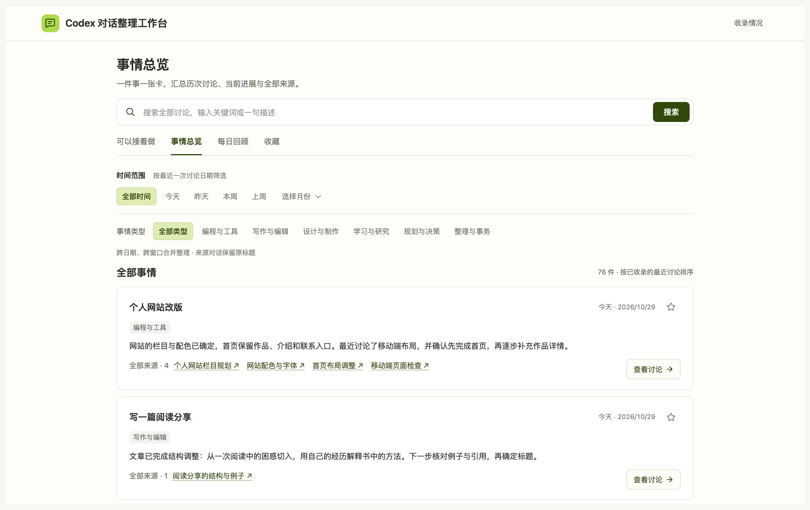
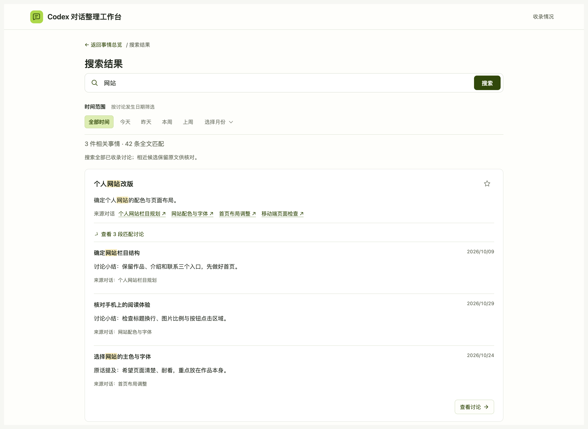

# Codex 对话整理工作台

**聊过的事，不必再翻几十个窗口。**

给 Codex 装上这个 Skill，就能把散落的讨论整理成一个本地网页：找以前的方案、回看做过的决定，或者看看哪些事情还可能继续。



> 图片基于实际界面加工，展示内容已替换为通用示例，并非真实私人对话。标注用于说明功能，页面以实际安装版本为准。

## 为什么做这个工具？

做这个工作台，起初只是因为一个很具体的麻烦：**Codex 越用越多，聊过的东西却越来越难找。**

有时记得讨论过一个方案，却忘了窗口叫什么；有时同一件事分散在几个窗口里，想弄清最后决定了什么，需要来回翻。还有些事情做到一半被打断，过几天回来，已经想不起上次停在哪里。

给窗口改名、分类、置顶，能解决一部分问题，但又多了一份整理工作。我们想要的是：继续照常和 Codex 聊，由它帮忙整理，之后用一个清楚的页面找回来。

这个工作台就是这样一点点做出来的。它的用处是让已经聊过、想过、决定过的内容更容易被再次用上，少花一点时间重新寻找、重新解释。

## 打开以后，能帮我做什么？

### 把同一件事放在一起

比如，你在一个窗口讨论个人网站的结构，在另一个窗口比较配色。“事情总览”会把它们整理到同一件事下面，显示小结和来源。

你先认出事情，再看讨论，不用先想起那个窗口的名字。来源链接也可以用来打开对应的 Codex 对话。

### 记不清原话，也可以试着找

输入几个关键词，或者一句大概描述，例如“之前那个周末旅行安排”。工作台会展示相关事情和相近候选，再带你回到对应讨论。

它不能保证每种说法都能找到，但不要求你把当时的原话一字不差地复述出来。



### 中断以后，看看上次聊到哪里

“可以接着做”会整理可能尚未结束的事情、进行中的项目，以及可能继续讨论的内容。

如果已经在别处处理完了，可以让它不再显示，不必专门回原窗口补一句话。判断不确定的内容会单独放在“进展待确认”中。


另外还有两个简单入口：

- **每日回顾**：按日期看当天聊了什么、事情有了哪些变化。想找某天的内容，可以直接选时间。
- **收藏**：临时留下想再看的事情，下次少翻几步。

## 我不会写代码，怎么开始？

你需要在电脑上使用支持本地 Skill 的 Codex。Skill 可以理解成给 Codex 安装的一套操作流程，它会按步骤帮你建立工作台。

**第一步：在 Codex 中打开一个新对话，把下面这段发给它。**

```text
请安装这个 Skill，并带我完成首次初始化：
https://github.com/LuKK351/lukk-codex-workbench
```

**第二步：回答几个与你有关的问题。**

它会问你想先整理哪些时间的 Codex 讨论、工作台存在哪里，以及是否使用默认分类。不用先手动整理所有窗口，也不用自己设计一套分类方法。

建议先整理近期内容，看看工作台是否能帮你找回讨论、看清事情进展，之后可以继续补充更早的内容。需要整理的对话越多、内容越长，首次等待通常也越久。

| 整理范围 | 适合的情况 | 建议 |
| --- | --- | --- |
| **近 1 个月（推荐起步）** | 你几乎每天都在 Codex 里讨论或处理事情，已经积累了不少窗口；想先看看这些内容整理成工作台后的效果。 | 先整理近期内容，确认小结、分类和查找方式是否符合需要，再补充更早的讨论。 |
| **近 3 个月** | 你只是偶尔使用 Codex，最近一个月的内容不多；或者需要一起回看过去几个月持续推进的事情。 | 覆盖更长一段时间。如果每天都有大量讨论，这个范围也可能需要较长时间整理。 |
| **自选时间范围** | 你已经知道想找哪个时期的内容，例如半年前讨论过的一个方案。 | 直接选择相关日期，不必为了找旧讨论，把中间所有月份都整理一遍。 |

**第三步：等待整理，打开给你的网页地址。**

建议把给你的地址放到常用浏览器里打开。收藏和“接着做”的确认、移出选择保存在当前浏览器，换到 Codex 内置浏览器或其他浏览器时不会自动同步。

先找一件你记得的事情，看看小结和原话是否对得上。历史越多，首次整理需要的时间越长。你可以先看首批网页，Codex 会继续分批处理选定范围，不需要每批都催一次“继续”。遇到无法读取的内容或运行中断，会保存进度并说明缺口；恢复后接着整理，不从头重做。

如果安装后 Codex 还没识别到 Skill，重新打开 Codex 或新建对话，再发：

```text
使用 $lukk-codex-workbench，帮我建立对话整理工作台。
```

## 以后怎么用？

平时打开网页，搜索或回看就可以了。新聊了内容，想更新时对 Codex 说：

> 更新一下我的对话整理工作台。

想少记一个步骤，也可以让 Codex 帮你设置定时更新，例如：

> 帮我设置每天晚上 9 点更新工作台。

定时功能需要你的 Codex 环境支持，并保持相关运行环境可用。它不会在安装时自动开启。

## 开始前，你可能还想知道

**它会改动我原来的 Codex 对话吗？**

不会。它读取已授权的讨论，另外生成工作台，不会替你删掉或修改原对话。

**是不是安装后就能看到全部历史？**

不一定。首次由你选择范围，实际能收录多少还取决于当前环境能读取哪些正文。读不到或不完整的部分会说明，不会拿摘要冒充原话。目前整理 Codex 对话，不包含 ChatGPT 对话和附件正文。

**我的内容会被公开吗？**

工作台文件保存在你自己的电脑上，安装这个公开仓库不会把你的聊天上传到 GitHub。整理时仍由你的 Codex 环境处理内容，并不意味着 AI 整理完全离线。分享给朋友时，发本仓库链接即可，不要分享装有私人内容的工作台文件夹。

**重启电脑，收藏会消失吗？**

普通重启通常不会。收藏保存在当前浏览器；清除本站数据会丢失，换浏览器或网页地址也不会自动同步。它适合临时回看。

**Windows 能用吗？**

已做 Windows 兼容处理，也提供 macOS 和 Linux 的运行方式。目前 macOS 已实测，Windows 和 Linux 尚未完成原生实机验收。安装时 Codex 会检查必要环境，遇到问题可把提示发给它继续处理。

**网页地址打不开了怎么办？**

本地网页需要相应程序运行。关闭后可以对 Codex 说“帮我重新打开工作台”。本版没有默认开机自启。

---

想了解运行要求、存储位置或维护方法，可以看[技术说明](docs/technical.md)。使用中遇到问题，欢迎在 [Issues](https://github.com/LuKK351/lukk-codex-workbench/issues) 描述；请不要贴私人对话或完整工作台数据。
